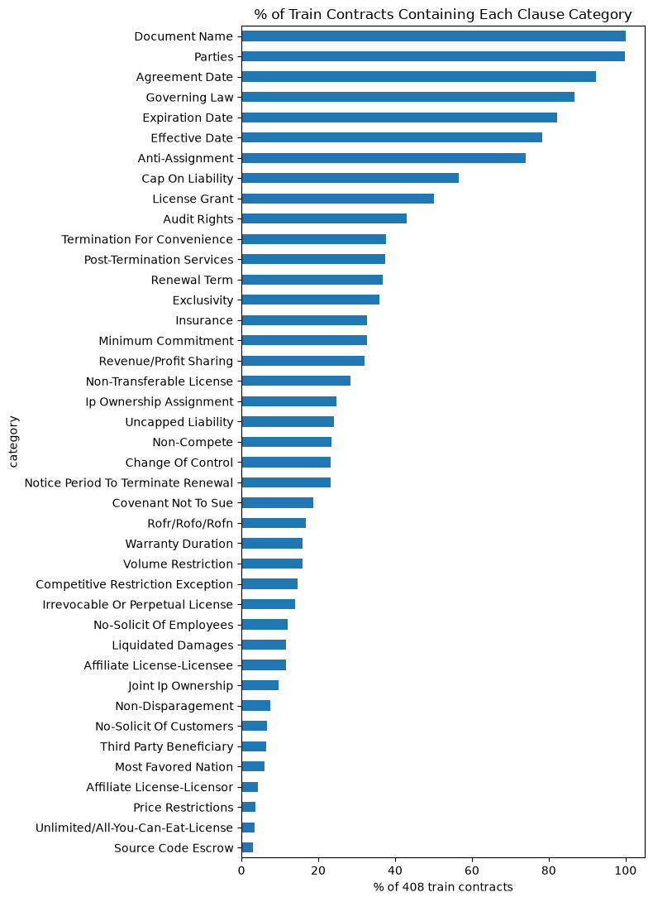
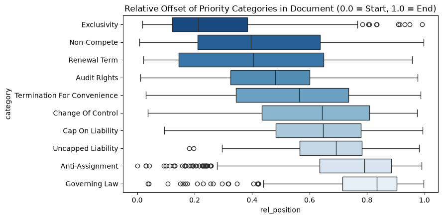
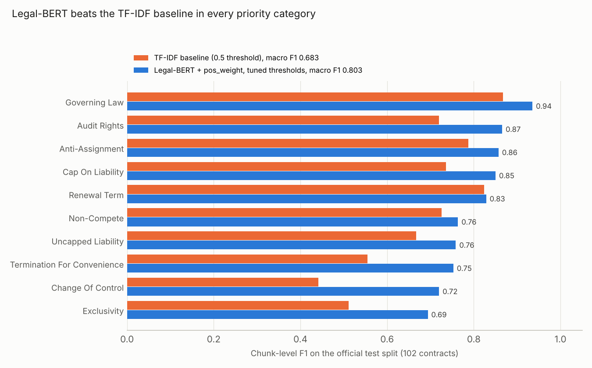

# Contract Clause Detection and Risk Triage (Accenture 1T, Break Through Tech AI Studio)

An NLP pipeline that reads commercial contracts, finds the clauses legal and procurement teams care about most, and (in progress) scores them Low / Medium / High risk so reviewers know which contracts to open first. Built on the CUAD dataset by a team of seven Break Through Tech AI Fellows for Accenture.

**Headline result:** a fine-tuned Legal-BERT classifier reaches **0.803 macro F1** on the official CUAD test split across 10 priority clause categories, up from **0.683** for the best TF-IDF baseline. At the contract level it reaches **0.896 macro F1**, a gain of **+6.7 points** over the baseline with a paired 95% interval of +2.5 to +11.1.

---

## 👥 Team Members

| Name | GitHub Handle | Contribution |
|---|---|---|
| Nia Bardavelidze | [@NiaBiaCodes](https://github.com/NiaBiaCodes) | Masked multi-label BERT training pipeline (`src/train.py`, `src/model.py`, `src/loss.py`) and Colab launcher |
| Thierno Diallo | [@nothier7](https://github.com/nothier7) | Chunking strategy experiment (Task 5), chunking implementation and export (Task 6), contract-level evaluation report with bootstrap intervals (Task 14) |
| Arpita Goradia | [@arpita-goradia](https://github.com/arpita-goradia) | TF-IDF multi-label baseline (Task 7), final Legal-BERT training pipeline and the single locked test run (Task 13) |
| Inika Goyal | [@Inika-Goyal](https://github.com/Inika-Goyal) | Keyword / rule baseline (Task 8), class-imbalance experiment that selected `pos_weight` (Task 12) |
| Nia Lam | [@nlam50](https://github.com/nlam50) | Priority scoping notebook (Task 4), chunk labeling and validation (Task 6), encoder and tokenizer model selection (Task 10) |
| Stephanie Nicolaescu | [@snic29](https://github.com/snic29) | Exploratory data analysis (Stage 2), sampled test-set mistake analysis and November recommendations |
| Wayne Simmons | [@WayneS0628](https://github.com/WayneS0628) | Stage 1 CUAD loader and cleaning (`src/cuad_data.py`, `notebooks/datacleaning.ipynb`), project environment (`pyproject.toml`, `uv.lock`), shared evaluation module with per-category threshold tuning and contract-grouped CV folds (`src/evaluation.py`, Task 9), risk rubric and advisor reference set for risk scoring (Milestone 3) |

---

## 🎯 Project Highlights

- Fine-tuned **Legal-BERT** (`nlpaueb/legal-bert-base-uncased`) for multi-label clause classification over 510 contracts and 10 advisor-priority clause categories.
- Reached **0.803 chunk macro F1** and **0.896 contract macro F1** on the official held-out test split, beating TF-IDF in **all 10 categories**.
- Lifted the hardest categories the most: **Change Of Control 0.44 → 0.72**, **Termination For Convenience 0.55 → 0.75**, **Exclusivity 0.51 → 0.69** F1.
- Kept evaluation honest: one shared scoring module for every model, thresholds tuned only on out-of-fold training predictions, contract-grouped folds to prevent leakage, and a test split that the code **refuses to score twice**.
- Every prediction keeps its evidence span and character offsets, so a reviewer can see exactly which text triggered a flag.

---

## 🏗️ Project Overview

**Program connection.** This is our Fall 2026 Break Through Tech AI Studio project. AI Studio pairs Fellow teams with an industry host company to work on a real, scoped ML problem from September to December.

**Host company and objective.** Accenture asked us to build a pipeline that goes from raw contract text to **clause category → evidence → risk level → rationale → contract-level triage score**. Clause detection uses chunk-based multi-label classification with a fine-tuned transformer encoder. Risk scoring is a separate, explainable rule-based layer, because CUAD has no risk labels.

**Why it matters.** Legal and procurement teams review tens of thousands of contracts a year, and only a small share of clauses carry real risk (uncapped liability, change of control, exclusivity, and so on). A triage tool that surfaces those clauses with evidence lets reviewers prioritize which contracts to open first instead of reading every page.

**Scope.** We focus on 10 advisor-priority categories out of CUAD's 41:

`Cap On Liability` · `Uncapped Liability` · `Governing Law` · `Anti-Assignment` · `Change Of Control` · `Termination For Convenience` · `Exclusivity` · `Non-Compete` · `Renewal Term` · `Audit Rights`

| Milestone | Focus | Status |
|---|---|---|
| September | Data prep, EDA, chunking, TF-IDF and keyword baselines | ✅ Done |
| October | Transformer selection, class imbalance, fine-tuning, error analysis | ✅ Done |
| November | Risk-scoring layer, end-to-end pipeline, validation against advisor rankings | 🔄 In progress |

---

## 📊 Data Exploration

**Dataset.** [CUAD v1](https://www.atticusprojectai.org/cuad/) (Contract Understanding Atticus Dataset, NeurIPS 2021) from The Atticus Project: 510 commercial contracts with 13,823 expert-annotated spans across 41 categories, in SQuAD-style JSON. We use the official contract-level split: **408 train / 102 test**. The data ships in [`data/`](data/README.md) (CC BY 4.0), so the project runs without any download.

**Preprocessing (Stage 1).** `src/cuad_data.py` turns the JSON into three tables per split:

| Table | One row per | Used for |
|---|---|---|
| `contracts` | contract | Raw text and length |
| `spans` | annotated clause | Category, evidence text, `[start, end)` character offsets, quality flags |
| `grid` | contract × category | Presence / absence, including the zeros |

The key design decision: **contract text stays byte-for-byte identical to the source.** Every CUAD label is a character offset into that string, so any cleaning that changes its length silently corrupts all 13,823 annotations. Cleaning is applied only to extracted span text (`text_clean`), and `verify_offsets` checks every span still lines up.

**Key EDA insights** ([`notebooks/eda.ipynb`](notebooks/eda.ipynb)):

- Contract length is heavily right-skewed: half are under ~33,000 characters, the longest exceed 300,000. Contracts must be chunked to fit a 512-token encoder.
- Strong class imbalance: metadata categories appear in nearly every contract, while substantive risk clauses appear in only **25% to 55%** of training contracts.
- Clauses have predictable positions: `Exclusivity` sits early (median offset ~0.20), `Governing Law` near the end (~0.83).
- Contracts are missing a mean of **5.58 of the 10** priority categories, and only 3 of 408 contain all 10. Absence of a protective clause is itself a risk signal.
- SEC redactions (`[***]`) cluster in the riskiest categories: 13.9% of `Uncapped Liability` spans are redacted.

<p align="center">
  
  
</p>

**Challenges and assumptions.** Chunks can cut a clause in half, so spans that only partially overlap a chunk are **masked** out of the loss and scoring rather than labeled negative. Low-support categories (`Uncapped Liability` has 16 positive test chunks) make some per-category scores noisy.

---

## 🧠 Model Development

**Chunking.** Paragraph-aware windows of up to 510 tokens with 128 tokens of overlap, preferring to end at a paragraph or sentence break. On the 408 training contracts this keeps **99.6%** of priority annotations fully inside at least one chunk ([`docs/chunking-strategy.md`](docs/chunking-strategy.md)).

**Baselines.** Two floors the transformer had to beat:
- A transparent regex keyword baseline with no fitted parameters ([`docs/keyword-baseline.md`](docs/keyword-baseline.md)).
- TF-IDF + one-vs-rest logistic regression, with per-category thresholds tuned on out-of-fold predictions so the bar is not artificially low ([`docs/tfidf-baseline.md`](docs/tfidf-baseline.md), [`docs/tuned-baseline.md`](docs/tuned-baseline.md)).

**Encoder selection.** We compared `bert-base-uncased`, `legal-bert-base-uncased` and `deberta-v3-base` on a short fine-tuning test. Legal-BERT won, on the condition that chunks are rebuilt with its own tokenizer so no labeled evidence overflows 512 tokens ([`docs/model-selection.md`](docs/model-selection.md)).

**Class imbalance.** Plain BCE, `pos_weight`, focal loss and negative downsampling were each trained on all 5 folds. `pos_weight` won on macro F1 (0.697 vs 0.568 for plain BCE) and on the weakest categories, with every 95% interval excluding zero ([`docs/class-imbalance.md`](docs/class-imbalance.md)).

**Training setup** ([`docs/final-model.md`](docs/final-model.md)):

| Setting | Value |
|---|---|
| Encoder | `nlpaueb/legal-bert-base-uncased`, pinned revision `15b570cb` |
| Head | CLS + linear layer, one independent sigmoid per category |
| Loss | Masked BCE with `pos_weight` (negatives / positives per category) |
| Validation | 5 folds grouped by contract (`docs/tuned-baseline-results/folds.csv`) |
| Sweep | Learning rate 2e-5, 1 to 3 epochs; 3 epochs selected by a rule fixed before running |
| Thresholds | One per category, tuned on out-of-fold predictions, frozen before test |
| Hardware | Tesla T4 (Kaggle / Colab), batch size 8, 10% linear warmup, weight decay 0.01 |
| Metric | Macro F1 (accuracy is misleading under this imbalance), plus AP and contract-level F1 |

---

## 📈 Results & Key Findings

**Chunk level, official test split** (102 contracts, 3,029 chunks, scored once):

| Model | Macro F1 | Micro F1 | Macro AP |
|---|---:|---:|---:|
| Keyword / rule baseline | 0.545 | n/a | n/a |
| TF-IDF, 0.5 threshold | 0.683 | 0.716 | 0.742 |
| TF-IDF, tuned thresholds | 0.666 | 0.692 | 0.742 |
| **Legal-BERT + pos_weight, tuned thresholds** | **0.803** | **0.829** | **0.831** |

**Contract level** (is the clause type present anywhere in the contract?), with paired bootstrap intervals over 2,000 draws ([`docs/evaluation-report.md`](docs/evaluation-report.md)):

| Model | Macro precision | Macro recall | Macro F1 | Micro F1 |
|---|---:|---:|---:|---:|
| TF-IDF, 0.5 threshold | 0.832 | 0.847 | 0.829 | 0.869 |
| **Legal-BERT, tuned thresholds** | **0.912** | **0.885** | **0.896** | **0.923** |



Precision / recall curves for every category: [`docs/evaluation-results/contract_pr_curves.svg`](docs/evaluation-results/contract_pr_curves.svg)

**What we learned**

- **The biggest wins are on the hardest clauses.** Change Of Control gained 28 F1 points and Termination For Convenience 20, because these depend on context that bag-of-words features miss.
- **Formulaic clauses were already easy.** Governing Law (0.94), Audit Rights (0.87) and Anti-Assignment (0.86) are strong for every model.
- **Tuned thresholds matter for the transformer.** At a flat 0.5 the same Legal-BERT predictions give 0.768 macro F1; per-category thresholds add ~0.035, mostly by cutting false positives.
- **Remaining errors are legal-language problems, not random noise.** The mistake analysis ([`docs/category-mistake-analysis.md`](docs/category-mistake-analysis.md)) groups them into overlapping clause families, cap vs. uncapped semantics, annotation scope, and negation. Cap / Uncapped swaps are rare but high-impact.
- **Caveats.** Results come from one seed. Uncapped Liability rests on 13 predictions, and Non-Compete scores higher on test than in CV, which looks like a property of the split.

---

## 👩🏽‍💻 Setup and Installation

**Requirements:** Python 3.12+, [uv](https://docs.astral.sh/uv/getting-started/installation/), and a GPU (Colab or Kaggle T4 is enough) for full transformer training. Everything else runs on CPU.

**1. Clone and install**

```sh
git clone https://github.com/Break-Through-Tech/Accenture-1T-contract-review-challenge.git
cd Accenture-1T-contract-review-challenge
uv sync --locked --dev
```

This creates `.venv` with the exact versions in `uv.lock` (PyTorch, Transformers, Accelerate, scikit-learn, Jupyter, pytest). In VS Code, select `.venv` as the interpreter and notebook kernel.

**2. Check the install**

```sh
uv run pytest
```

**3. Build the data tables and chunks** (the raw CUAD files are already in `data/`)

```sh
uv run --locked python -B -m src.cuad_data            # Stage 1: contracts / spans / grid parquets
uv run --locked python -B -m scripts.export_chunks --split train
uv run --locked python -B -m scripts.label_chunks  --split train
uv run --locked python -B -m scripts.export_chunks --split test
uv run --locked python -B -m scripts.label_chunks  --split test
```

**4. Run the baselines** (CPU, a few minutes each)

```sh
uv run --locked python -B -m scripts.keyword_baseline
uv run --locked python -B -m scripts.tfidf_baseline
uv run --locked python -B -m scripts.tuned_baseline
```

**5. Train the model**

Quick CPU smoke test (tiny random BERT, checks the mechanics only):

```sh
uv run --locked python -B -m src.train --tiny --max-contracts 20 --batch-size 8 --learning-rate 0.001 --device cpu --output-dir data/interim/models/transformer-smoke-tiny-20
```

Full training on a GPU: open [`notebooks/final_training_colab.ipynb`](notebooks/final_training_colab.ipynb) on a T4 runtime and run all cells, or run the steps yourself:

```sh
uv run --locked python -B -m scripts.final_training prepare
uv run --locked python -B -m scripts.final_training sweep --learning-rate 2e-5 --validation-fold 0 --output-dir RUNS   # repeat for folds 0-4
uv run --locked python -B -m scripts.final_training select --runs-dir RUNS
uv run --locked python -B -m scripts.final_training final --output-dir FINAL
```

**6. Evaluate**

```sh
uv run --locked python -B -m scripts.final_training test --checkpoint FINAL/checkpoint --output-dir FINAL   # scores the test split once, then locks
uv run --locked python -B -m scripts.evaluation_report                                                    # contract-level metrics, intervals, PR curves
```

Model weights (~440 MB) are not stored in Git. Dependencies are managed with `uv add <package>`; commit both `pyproject.toml` and `uv.lock`.

---

## 📁 Repository Structure

```
├── data/                CUAD v1 JSON, category descriptions, provenance (data/README.md)
├── notebooks/           Cleaning, EDA, scoping, and Colab notebooks for training runs
├── src/                 Reusable library code (see Code Reference)
├── scripts/             Command-line entry points for each task
├── tests/               pytest suite with fixtures
├── docs/                Per-task write-ups and committed result tables
└── assets/              Figures used in this README
```

## 📚 Documentation and Code Reference

Each task has a write-up in [`docs/`](docs/) with the exact commands, decisions and results, so any step can be replicated on its own.

| Module | What it provides |
|---|---|
| `src/cuad_data.py` | `load_split`, `build_split`, `verify_offsets`, `check_leakage`, `PRIORITY_CATEGORIES` |
| `src/chunking.py` | `ChunkingConfig`, `chunk_contracts`, `validate_chunks` |
| `src/labeling.py` | `label_chunks`, `build_evidence`, `validate_labels` (positive / masked labels per chunk) |
| `src/evaluation.py` | `score`, `tune_thresholds`, `apply_thresholds`, `contract_folds` (shared by every model) |
| `src/keyword_baseline.py` | Regex `Rule` set with `predict` and `explain` |
| `src/tfidf_baseline.py` | `TfidfBaseline` with `fit`, `evaluate`, `cross_validate` |
| `src/candidates.py` | Encoder candidates and tokenizer length checks |
| `src/dataset.py` | `ChunkDataset` for PyTorch |
| `src/model.py`, `src/loss.py` | `ContractClassifier`; masked BCE and focal losses |
| `src/imbalance.py` | Imbalance strategies and paired bootstrap comparison |
| `src/train.py` | Training CLI (`python -m src.train --help`) |
| `src/final_training.py` | Sweep, config selection, final fit, checkpointing, one-time test scoring |

---

## 🚀 Next Steps

- **Risk-scoring layer (November).** An explainable rule-based Low / Medium / High score per clause, rolled up into a contract triage score, validated by Spearman correlation and bucket agreement against the advisor's hand-ranked clauses, plus a sensitivity check on the High / Medium boundary.
- **Calibrate probabilities** before using them as risk inputs.
- **Targeted fixes for confused clause families** (Cap vs. Uncapped Liability, Exclusivity vs. Non-Compete) through post-processing rules and an annotation-quality pass on the weakest categories.
- **More seeds** to firm up the model-selection and final results.
- **Stretch goals:** span extraction, LLM-generated clause explanations, broader category coverage, and a Streamlit demo for reviewers.

---

## 📝 License

Code license to be confirmed with our Challenge Advisor. The CUAD data is licensed [CC BY 4.0](https://creativecommons.org/licenses/by/4.0/) by The Atticus Project.

## 📄 References

- Hendrycks, D., Burns, C., Chen, A., & Ball, S. (2021). *CUAD: An Expert-Annotated NLP Dataset for Legal Contract Review.* NeurIPS Datasets and Benchmarks. [arXiv:2103.06268](https://arxiv.org/abs/2103.06268)
- Chalkidis, I., Fergadiotis, M., Malakasiotis, P., Aletras, N., & Androutsopoulos, I. (2020). *LEGAL-BERT: The Muppets straight out of Law School.* Findings of EMNLP. [arXiv:2010.02559](https://arxiv.org/abs/2010.02559)
- [CUAD official repository](https://github.com/TheAtticusProject/cuad)

## 🙏 Acknowledgements

Thank you to our Challenge Advisor **Lipika Mukherjee** (Accenture), our AI Studio Coach **Julio Contreras**, and the Break Through Tech AI team for their guidance and support.
